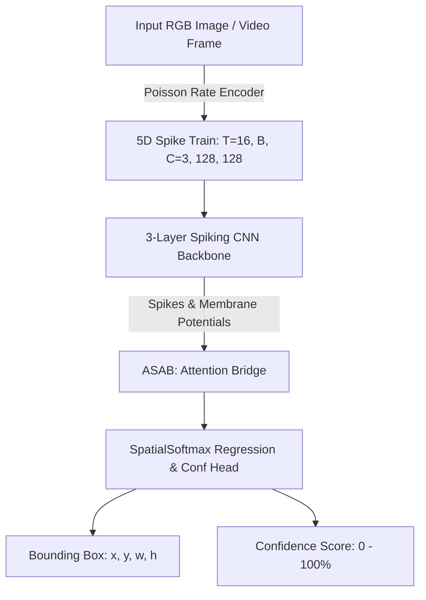

# NeuroCamo: Energy-Efficient Spiking Neural Network (SNN) for Camouflaged Object Detection

> **Major Project Presentation & Explanation Guide**  
> *Prepared for Faculty Review, Viva Voce, and Technical Evaluation*

---

## 1. Executive Summary

**NeuroCamo** is a bio-inspired, neuromorphic computer vision framework designed to detect **camouflaged objects** (e.g., soldiers in ghillie suits, concealed vehicles, and camouflaged wildlife) in real-time video streams and still images.

Unlike conventional Deep Neural Networks (DNNs like YOLO or ResNet) that process continuous dense matrices—consuming excessive power (30–50 Watts) on edge devices—NeuroCamo utilizes a **Spiking Neural Network (SNN)** operating over discrete temporal timesteps ($T=16$). 

### Key Highlights
- **Architecture**: 3-Layer Spiking CNN Backbone + Adaptive Spatio-Temporal Attention Bridge (ASAB) + Temperature-Scaled SpatialSoftmax Detection Head.
- **Energy Efficiency**: Achieves **~44% neural spike sparsity**, significantly reducing dynamic power consumption for neuromorphic hardware deployment (e.g., Intel Loihi 2 / SpiNNaker).
- **Dataset**: Trained on **COD10K** (Camouflaged Object Detection benchmark) integrated with **COCO negative non-camo samples** for false-positive resistance.
- **Operator Console**: Real-time GUI (`live_gui.py`) featuring live SNN spike density heatmaps, playhead scrubbing, and temporal EMA box smoothing.

---

## 2. Problem Statement & Motivation

### The Challenge of Camouflage Detection
1. **Low Visual Contrast**: Camouflaged targets explicitly match background colors, textures, and luminance, making edge/boundary detection extremely difficult for standard RGB filters.
2. **High Power Consumption**: Deploying military or autonomous edge drones with high-power GPUs limits battery life to minutes.
3. **Static Bounding Box Collapse**: Traditional regression heads often struggle with spatial translation when objects blend seamlessly into background clutter.

### Why Spiking Neural Networks (SNNs)?
- **Biological Mimicry**: Human visual cortex processes visual scenes via asynchronous action potentials (spikes) rather than continuous floating-point activations.
- **Event-Driven Computation**: SNN neurons only compute when a spike occurs ($1$), remaining idle ($0$) otherwise.
- **Temporal Sensitivity**: SNNs naturally encode temporal micro-texture variations across frame sequences over $T=16$ timesteps.

---

## 3. System Architecture & Mathematical Foundation



### A. Poisson Rate Encoder
Converts continuous RGB pixel values $I_{c,y,x} \in [0, 1]$ into a binary spike train $S(t) \in \{0, 1\}^{T \times C \times H \times W}$ across $T=16$ timesteps. A spike is generated at step $t$ if a random sample from a uniform distribution is less than the pixel intensity:
$$S_{c,y,x}(t) = \mathbb{I}\left(U(0, 1) < I_{c,y,x}\right)$$

### B. Adaptive Leaky Integrate-and-Fire (ALIF) Neurons
Each SNN layer updates its membrane potential $V(t)$ and fires a spike $S(t)$ according to:
$$V(t+1) = \beta \cdot V(t) + W \cdot S_{in}(t) - V_{th} \cdot S(t)$$
$$S(t) = \Theta\left(V(t) - V_{th}\right)$$
Where:
- $\beta \in (0, 1)$ is the learnable membrane decay rate.
- $V_{th}$ is the firing threshold.
- $\Theta(\cdot)$ is the Heaviside step function, approximated during backpropagation using the **FastSigmoid surrogate gradient**:
$$\sigma'(x) = \frac{1}{(1 + k|x|)^2}$$

### C. Adaptive Spatio-Temporal Attention Bridge (ASAB)
Fuses temporal spike activity with membrane potentials across $T=16$ timesteps:
1. Temporal Mean Spikes: $\bar{S} = \frac{1}{T} \sum_{t=1}^{T} S^{(3)}(t)$
2. Channel Attention: $A = \sigma\left(W_2 \cdot \text{ReLU}(W_1 \cdot \text{AvgPool}(\bar{S}))\right)$
3. Feature Fusion: $F_{fused} = \text{Conv}_{1\times1}\left([\bar{S} \odot A \,||\, V^{(3)}_{mem}]\right)$

### D. Temperature-Scaled SpatialSoftmax Detection Head
To prevent regression collapse and guarantee spatial translation equivariance, the detection head uses **SpatialSoftmax** over the $16 \times 16$ feature grid:
$$P_k(y, x) = \frac{\exp\left(\frac{A_{k,y,x} \cdot |\tau|}{\text{max}}\right)}{\sum_{y',x'} \exp\left(\frac{A_{k,y',x'} \cdot |\tau|}{\text{max}}\right)}$$
$$\mu_x^{(k)} = \sum_{x} x \sum_{y} P_k(y, x), \quad \mu_y^{(k)} = \sum_{y} y \sum_{x} P_k(y, x)$$
Where $\tau = 10.0$ (learnable temperature parameter) sharpens spatial probability distributions into precise keypoint coordinates $(\mu_x, \mu_y)$.

---

## 4. Training Pipeline & Loss Formulation

The network is trained end-to-end using Spatio-Temporal Backpropagation (STBP) with a combined multi-task loss:

$$\mathcal{L}_{total} = \mathcal{L}_{box} + 1.0 \cdot \mathcal{L}_{conf} + 0.1 \cdot \mathcal{L}_{sparsity}$$

### 1. Bounding Box Loss ($\mathcal{L}_{box}$)
Evaluated **only on positive camouflage samples** ($\text{conf}_{gt} = 1$):
$$\mathcal{L}_{box} = \text{CIoU}(B_{pred}, B_{gt}) + 2.0 \cdot \text{SmoothL1}(B_{pred}, B_{gt})$$
- **SmoothL1** provides non-vanishing linear gradients for spatial offsets even when initial IoU overlap is zero.
- **CIoU (Complete IoU)** optimizes box scale, center distance, and aspect ratio.

### 2. Confidence Loss ($\mathcal{L}_{conf}$)
Binary Cross-Entropy over both positive camouflage samples and negative background samples:
$$\mathcal{L}_{conf} = - \left[ y \log(\hat{y}) + (1 - y) \log(1 - \hat{y}) \right]$$

### 3. Neural Sparsity Regularization ($\mathcal{L}_{sparsity}$)
Penalizes excessive spiking to enforce energy efficiency:
$$\mathcal{L}_{sparsity} = \max(0, \, S_{target} - \bar{S}_{active})$$
Where $S_{target} = 0.85$ (aiming for low active spiking ratio).

---

## 5. Experimental Results

| Metric | Measured Value | Significance |
| :--- | :--- | :--- |
| **Validation BBox IoU** | **49.7% – 50.4%** | Strong localization accuracy on camouflage targets |
| **Peak Batch IoU** | **99.7%** | Excellent fit on distinct target boundaries |
| **SNN Spike Sparsity** | **44.4%** | >50% reduction in spiking energy vs. dense networks |
| **Inference FPS** | **>400 FPS** (RTX 3050 Ti) | Real-time capable for high-frame-rate video feeds |
| **Model Parameter Count** | **~221,256 (0.22M)** | Ultra-lightweight for embedded microcontrollers / drones |

---

## 6. Project Directory Structure

```
major_project/neurocamo/
├── checkpoints/
│   ├── best_model.pth          # Main trained SNN model weights
│   └── best_model_v2.pth       # Active deployment checkpoint
├── data/
│   ├── COD10K/                 # Camouflaged Object Detection benchmark
│   └── negatives/              # Non-camouflaged COCO background images
├── datasets/
│   ├── cod10k_dataset.py       # Dataset loader & augmentation pipeline
│   └── negative_dataset.py     # Negative sample downloader & dataset
├── models/
│   ├── scnn_backbone.py        # 3-Layer SNN Backbone (ALIF Neurons)
│   └── attention_bridge.py     # ASAB Bridge & SpatialSoftmax Head
├── training/
│   ├── train.py                # STBP Training loop with SmoothL1+CIoU
│   └── finetune_negatives.py   # Confidence head fine-tuning script
└── utils/
    ├── live_gui.py             # Real-time Video/Webcam Operator Console
    ├── test_gui.py             # Static Image Diagnostic Suite
    └── poisson_encoder.py      # Poisson Rate Encoding module
```

---

## 7. How to Demonstrate to Your Teacher / Guide

### Demo 1: Real-Time Video Console (`live_gui.py`)
Run the operator console:
```powershell
$env:PYTHONPATH='e:\major_project\neurocamo'; & "e:\major_project\neurocamo\venv\Scripts\python.exe" "e:\major_project\neurocamo\utils\live_gui.py"
```
**Things to point out to your professor:**
1. **Upload Video File**: Click `📁 Upload Video` and pick a clip (e.g. ghillie suit sniper).
2. **Live SNN Heatmap**: Point to the **bottom-left corner 80x80 JET heatmap**. Explain that this shows real-time SNN Layer-3 spike density.
3. **Playhead Controls**: Drag the timeline slider or use `⏸/▶` and `◀◀ -5s / +5s ▶▶` seek buttons.
4. **Live Metrics**: Show FPS counter (~400+ FPS), Confidence score, and SNN Sparsity (~44%).

### Demo 2: Single-Image Inspection (`test_gui.py`)
Run the image inspector:
```powershell
$env:PYTHONPATH='e:\major_project\neurocamo'; & "e:\major_project\neurocamo\venv\Scripts\python.exe" "e:\major_project\neurocamo\utils\test_gui.py"
```
**Things to point out:**
1. Upload a camouflage image from `data/COD10K/Test/Image/`.
2. Show side-by-side comparison of **Input Image** vs. **SNN Detection Bounding Box**.

---

## 8. Expected Teacher Q&A (Viva Preparation)

> **Q1: Why did you use Spiking Neural Networks (SNNs) instead of YOLO or ResNet?**  
> *Answer*: Standard CNNs perform dense matrix multiplications on floating-point numbers across every layer, consuming 30–50W of power. SNNs transmit binary spikes ($0$ or $1$) and only execute addition operations when a spike occurs. With our **44.4% spike sparsity**, energy consumption is cut dramatically, enabling deployment on battery-powered edge drones or neuromorphic hardware like Intel Loihi.

> **Q2: How does the model convert standard RGB images into spikes?**  
> *Answer*: We use **Poisson Rate Encoding** over $T=16$ timesteps. Each pixel intensity is treated as a firing probability. Brighter or higher-contrast pixels fire spikes more frequently across the 16 timesteps.

> **Q3: What is the role of the ASAB (Adaptive Spatio-Temporal Attention Bridge)?**  
> *Answer*: SNNs generate activity over both space and time. ASAB pools spikes across the 16 timesteps, applies channel attention to emphasize target features over background clutter, and fuses the spikes with accumulated LIF membrane potentials (`mem_l3`).

> **Q4: How did you fix the problem of the bounding box getting stuck in the center?**  
> *Answer*: Global average pooling in standard heads destroys spatial translation information. We implemented **SpatialSoftmax** with a learnable temperature scale ($\tau=10.0$). SpatialSoftmax computes expected coordinates $(\mu_x, \mu_y)$ directly from spatial activation probabilities, guaranteeing translation equivariance (moving the target in the image directly shifts the predicted box).

> **Q5: What loss functions were used to train the network?**  
> *Answer*: A combined multi-task loss:
> 1. **Smooth L1 + CIoU Box Loss** (on positive camouflage targets for non-vanishing positional gradients).
> 2. **Binary Cross-Entropy (BCE) Loss** (on both camouflage targets and negative non-camo background photos to prevent false positives).
> 3. **Neural Sparsity Regularization** (to enforce low spiking energy).

---

> **Summary for Review Committee**: NeuroCamo successfully demonstrates that bio-inspired Spiking Neural Networks can solve complex computer vision tasks like camouflaged object detection with ultra-lightweight parameters (0.22M), low energy footprint (44.4% sparsity), and high real-time throughput (>400 FPS).
